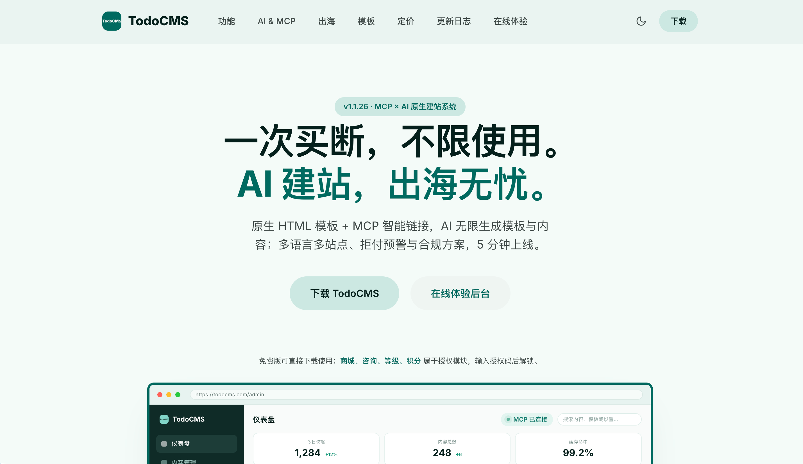
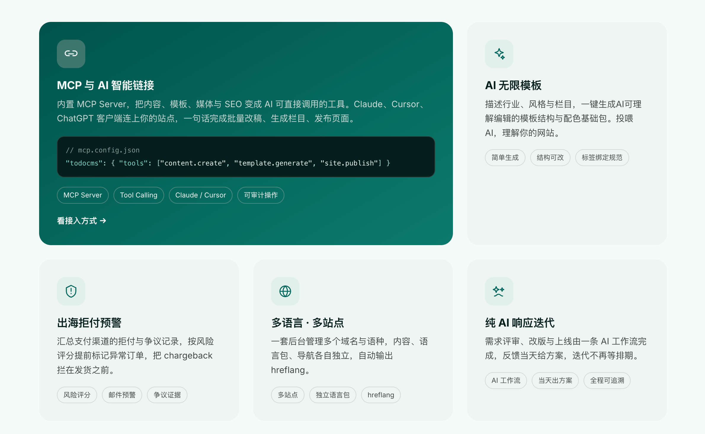
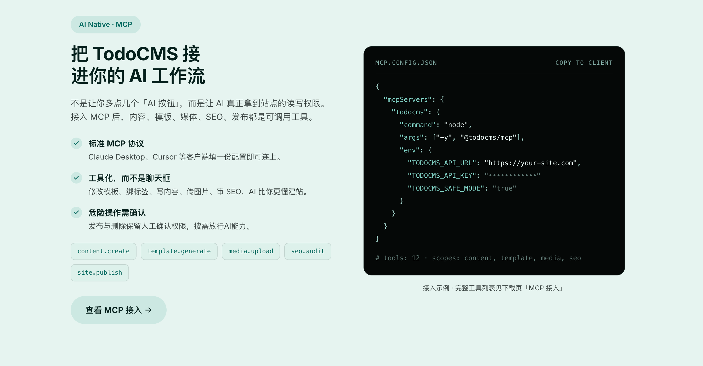

# TodoCMS 简单好用的PHP内容管理系统

> 面向独立开发者与出海团队的 AI 原生 PHP 建站系统

[](#环境要求)
[](#环境要求)
[](http://todocms.com)
[](#版本与授权)

TodoCMS 是一套轻量、模块化、面向 AI 工作流的 PHP 建站系统：原生 HTML 模板 + MCP 智能链接，一键生成AI可理解编辑的模板结构与配色基础包；内置多语言、多站点、统一缓存与商城能力，普通虚拟主机即可运行，无需 Composer / Node.js。

- 官网：<http://todocms.com>
- 在线体验（后台演示）：<http://demo.todocms.com/admin/login.php>
- GitHub：<https://github.com/todocms/TodoCMS>
- 交流 QQ 群：**527961813**





## 目录

- [功能特性](#功能特性)
- [技术架构](#技术架构)
- [环境要求](#环境要求)
- [部署说明](#部署说明)
- [目录结构](#目录结构)
- [本地开发](#本地开发)
- [标签文档](#标签文档)
- [版本与授权](#版本与授权)
- [交流与反馈](#交流与反馈)

---

## 功能特性

### AI 与 MCP 智能链接

- 标准化 **MCP Server**（`tools/todocms-mcp`），Claude Desktop、Cursor、ChatGPT 客户端填写一份配置即可连接站点。
- 内容、模板、媒体、SEO、发布等能力全部工具化，AI 按步骤执行而非停留在对话框。
- 你甚至可以让AI完成你想要的前端标签绑定，因为他比你懂更多。
- 发布、删除等危险操作保留人工确认权限，做到按需放行AI能力。
- AI 主题工作室：描述行业、风格与栏目，即可生成用于投喂AI的模板结构与配色主题包，有了它AI才更容易理解你的意图。
- SEO、GEO 友好化：LLM 索引支持，Schema.org JSON-LD 标记。

### 内容管理：数据变体模型

- **三层数据模型**：公共主表 + 模型特色表（独立物理列）+ 动态自定义字段表，兼顾扩展性与查询性能。
- **字段生成器**：支持文本、多行、富文本、单选、多选、下拉、整数、小数、金额、单图、多图、附件、视频、日期时间、开关、区域联动 16 种字段类型，可在任意业务场景复用。
- **栏目 × 模型**：栏目创建时必须绑定模型，并支持栏目级字段可见性微调。
- **Tags 体系**：按栏目、按模型筛选与聚类，保留层级关系，便于 SEO 聚合页。

### 模板与主题

- 原生 HTML 模板 + 专属标签引擎（V2 标准）：`{{todo:if}}` / `{{todo:loop}}` / `{{todo:变量}}` / `{{literal}}`。
- 模板编译为 PHP 缓存，生产环境不做逐次正则解析。
- 主题支持 PC 与移动端独立模板目录，会员中心同样走模板化开发。如无移动端模版，则回退到 PC 模版。
- 官方维护default主题，作为标签使用与调试对照，请不要使用default命名自己的主题，否则系统升级就会被覆盖。
- AI 主题工作室：描述行业、风格与栏目，即可生成用于投喂AI的模板结构与配色主题包，有了它AI才更容易理解你的意图。

### 多语言 · 多站点

- 一套后台管理多个域名与语种，内容、语言包、导航各自独立。
- 自动输出 `hreflang`，语言切换与站点切换组件开箱可用。
- 多语言也可以是多站点 你可以将多语言改造成多站点使用，无限的内容版本管理和层级。
- 站点 在系统中更多是作为门店使用，用于独立区分标定内容。所以你可以根据业务场景，采用多站点 + 多门店 的业务架构。

### 商城与订单（授权模块）

- 多规格 SKU：现售价、原价、批发价、商品编码、库存、虚拟销量。
- 实物发货（物流单号）与虚拟交付（网盘地址、卡密自动发码、文本说明）。
- 订单状态机、7 天自动确认收货、售后通道与原路退款（余额）。
- 拒付风险预警，按环境及订单风险提前标记异常订单。

### 会员中心

- 静态模板 + 标签解析：登录、注册、找回密码、个人资料、收藏。
- 商城中心：购物车、收货地址、我的订单、评价晒单、售后申请。

### 性能与缓存

- `Todo_Unified_Cache_Manager` 统一管理页面缓存、编译模板、对象缓存。
- 动态微缓存与静态永不过期两种模式，支持双令牌（游客 / 管理员）隔离缓存。
- 智能预热：标签首页、栏目列表、全部详情页或自定义 URL 列表，CLI 子进程分批执行。
- 全站消除 N+1 查询，索引数组模式与批量预加载。
- 原子样式按需裁剪：主题携带的 Tailwind 全量底座在运行时按模板实际类名裁剪后输出（3.2MB → 百 KB 级）。

### 安全

- 全链路 CSRF Nonce 校验，后台表单遵循 PRG（Post-Redirect-Get）。
- 上传文件 Magic Bytes 二进制嗅探 + 随机哈希重命名，`content/uploads` 禁止脚本执行。
- 防火墙与采集拦截、安装后入口文件自动改名、敏感文件访问保护（`.htaccess` 内置规则）。

---

## 技术架构

```
请求 → index.php（前台唯一入口）
        └── core/bootstrap.php    内核装配：常量、Composer 类映射、错误处理、DB 引导
              ├── core/classes    领域管理器（单例 + 事件驱动）
              ├── core/functions  全局函数库（todo_ 前缀）
              ├── core/hooks      内置动作与过滤器挂载
              └── content/        主题、插件、上传、缓存等动态内容
```

- **分层解耦**：管理器类单一职责，业务通信统一走 `todo_do_action()` / `todo_apply_filters()`。
- **类加载**：Composer 权威类映射（classmap-authoritative），类文件统一 `class-*.php` 命名。
- **命名规范**：类 `Todo_` / `CMS_` 前缀，全局函数 `todo_` 前缀，常量 `TODO_` 前缀。

---

## 环境要求

| 项目 | 要求 |
| :--- | :--- |
| PHP | 7.4 ~ 8.5（推荐 8.0+），扩展：`mysqli` 或 `pdo_mysql`、`json` |
| 数据库 | MySQL 5.7+ / MariaDB 10.3+，字符集 `utf8mb4` |
| Web 服务器 | Apache 2.4（开启 `mod_rewrite`）或 Nginx，需支持伪静态 |
| 运行依赖 | 无需 Composer / Node.js（`vendor/` 仅内置自动加载器） |
| 可选 | 使用本地 MCP Server（`tools/todocms-mcp`）时需自备 Node.js |

---

## 部署说明

### 1. 获取代码

```bash
git clone https://github.com/todocms/TodoCMS.git
```

或直接下载官方安装包，解压到站点目录。

### 2. 上传并设置权限

将代码上传到站点根目录（支持二级目录部署），确保以下目录**可写**：

```bash
chmod -R 755 .
chmod -R 775 core content/themes content/plugins content/uploads content/cache logs
```

> 安装向导会检查站点根目录、`core`、`content/themes`、`content/plugins`、`content/uploads` 的写权限；`content/cache` 与 `logs` 为运行期写入目录。

### 3. 创建数据库

在 MySQL / MariaDB 中新建一个空库（推荐 `utf8mb4_unicode_ci`），并准备具备该库读写权限的账号。

### 4. 运行安装向导

浏览器访问：

```
https://你的域名/install.php
```

按向导完成四步：环境检查 → 填写数据库信息 → 初始化数据表 → 创建管理员账户。

- 安装完成后，`install.php` 会被**自动重命名**为 `install_<随机串>.php`，避免被再次访问。
- 如需重新安装，请先删除根目录的 `config.php` 并清空数据库。

### 5. 登录后台

安装成功页会给出后台入口。默认位于：

```
https://你的域名/admin/todo-login.php
```

> 出于安全考虑，登录入口文件名会根据配置被随机化。若访问不到，请查看服务器上 `admin/` 目录中的实际入口文件名。

### 6. 伪静态配置

Apache 已随包提供根目录 `.htaccess`（含路由重写与敏感文件保护），开启 `mod_rewrite` 并允许 `.htaccess` 生效即可。

Nginx 参考配置：

```nginx
server {
    listen 80;
    server_name your-domain.com;
    root /www/wwwroot/todocms;
    index index.php;

    # 伪静态路由
    location / {
        try_files $uri $uri/ /index.php?$query_string;
    }

    location ~ \.php$ {
        include fastcgi_params;
        fastcgi_pass unix:/run/php/php-fpm.sock;
        fastcgi_param SCRIPT_FILENAME $document_root$fastcgi_script_name;
    }

    # 上传目录与缓存目录禁止执行脚本
    location ~* ^/content/(uploads|cache)/.*\.php$ {
        deny all;
    }

    # 保护配置文件
    location ~* ^/(config\.php|config-sample\.php)$ {
        deny all;
    }
}
```

### 7. 上线前检查

- 全站启用 HTTPS，并在后台把站点地址设置为 `https://`。
- 确认根目录 `config.php` 中 `TODO_DEBUG` 为 `false`。
- 确认 `content/uploads`、`content/cache`、`logs` 的目录权限与属主正确。
- 配置定时备份（数据库 + `content/uploads`）。
- 后台执行一次「清除缓存」，随后按需「生成缓存」。

---

## 目录结构

```
todocms/
├── index.php               前台唯一入口
├── install.php             安装向导（安装完成后自动改名）
├── config-sample.php       配置模板（安装时生成 config.php）
├── core/                   系统内核
│   ├── classes/            领域管理器与服务类（class-*.php）
│   ├── db/                 数据库架构与迁移定义
│   ├── functions/          全局函数库（todo_ 前缀）
│   ├── hooks/              系统内置钩子
│   ├── config/             性能、缓存等配置
│   └── bootstrap.php       内核装配中心
├── admin/                  后台管理（iframe 微应用 + 统一弹窗组件）
│   ├── pages/              后台页面
│   ├── ajax/               后台异步端点
│   └── assets/             后台静态资源
├── api/                    开放接口与异步端点
├── content/
│   ├── themes/             前台与会员中心主题
│   ├── plugins/            插件扩展
│   ├── uploads/            媒体与附件（禁止脚本执行）
│   └── cache/              编译模板 / 页面 / 对象 / 样式产物缓存
├── public/static/          公共静态资源（基础样式、图标、脚本）
├── includes/               支付、商城、语言等模块
├── tools/todocms-mcp/      本地 MCP Server（可选）
└── vendor/                 Composer 自动加载器
```

---

## 本地开发

```bash
# 1. 重建 Composer 权威类映射（新增 / 重命名类后必须执行）
composer dump-autoload -o

# 2. 快速预览（伪静态请使用 Nginx / Apache）
php -S 127.0.0.1:8000
```

调试开关位于 `config.php`：

```php
define('TODO_DEBUG', true);   // 生产环境务必为 false
```

---

## 标签文档

后台 > 主题 > 模板标签手册 /admin/index.php?page=template-tags

---

## 版本与授权

- 当前稳定版：**v1.1.26**（更新日志见官网 <http://todocms.com>）。
- **免费版**：内容管理、邮件、多语言多站点、SEO、MCP 与 AI主题工作室等核心能力可长期免费使用。
- **授权模块**：商城系统（商品 / 订单 / 支付 / 售后）与产品咨询/等级/积分为关联授权模块，未授权时入口隐藏、不影响站点其他功能，激活后即时解锁。
- 本项目采用 **Proprietary（专有）授权**，非开源协议；使用、二次开发与分发请遵循官方授权条款。
- 项目内使用的第三方开源组件及其协议见 [THIRD-PARTY-LICENSES.md](THIRD-PARTY-LICENSES.md)。

---

## 交流与反馈

- 官方 QQ 群：**527961813**
- 问题反馈：<https://github.com/todocms/TodoCMS/issues>
- 官网与文档：<http://todocms.com>
- 在线体验后台：<http://demo.todocms.com/admin/login.php>

欢迎提交 相关问题反馈，便于快速bug定位。

---

如果 TodoCMS 对你有帮助，欢迎点一个 Star ⭐




